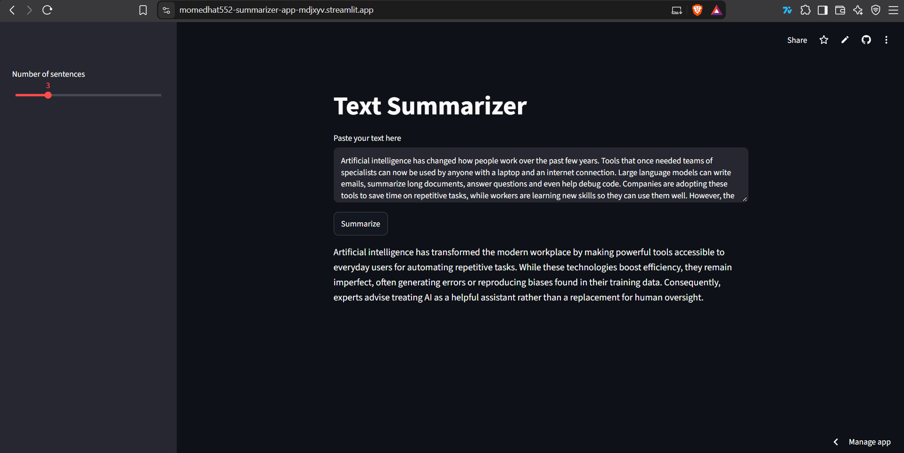

# Text Summarizer

**Live demo:** https://momedhat552-summarizer-app-mdjxyv.streamlit.app/

A Python tool that summarizes text using the Google Gemini API. Use it in the browser through a Streamlit web app, or from the command line.



## Features

- Summarize pasted text in the browser (Streamlit web app)
- Choose the summary length (1-10 sentences) from the sidebar
- Command-line version that accepts either text or a file path
- Input validation and error handling for empty input, bad arguments and API failures
- Automated tests with pytest and CI with GitHub Actions

## Tech stack

Python, Google Gemini API, Streamlit, python-dotenv, pytest, GitHub Actions

## Project structure

```
summarizer/
├── app.py              # Streamlit web app
├── summarizer.py       # Core summarize() function and command-line interface
├── requirements.txt
├── tests/              # pytest tests
└── README.md
```

## Run locally

1. Clone the repo and go into the folder:

```
git clone https://github.com/momedhat552/<your-repo-name>.git
cd <your-repo-name>
```

2. Install the dependencies:

```
pip install -r requirements.txt
```

3. Create a `.env` file in the project folder with your Gemini API key:

```
GEMINI_API_KEY=your-key-here
```

4. Start the web app:

```
streamlit run app.py
```

## Command-line usage

```
py summarizer.py "text or filename" [sentences]
```

- The first argument is either the text itself or the path to a `.txt` file.
- The second argument is optional and sets the number of sentences (default: 2).

Examples:

```
py summarizer.py "Python is a popular programming language." 1
py summarizer.py article.txt 3
```

## Tests

```
pytest
```

Tests also run automatically on every push through GitHub Actions.

## Deployment

The web app is deployed on Streamlit Community Cloud. The API key is stored in the app's Secrets settings and is never committed to the repository.